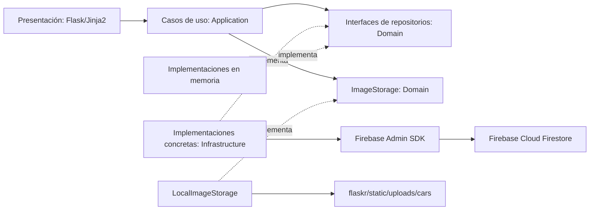

# Arquitectura desacoplada

## Enfoque

El proyecto aplica Clean Architecture con una separación pragmática para Flask. Las reglas del negocio viven en servicios de aplicación, el dominio define entidades y contratos, y la infraestructura implementa esos contratos con memoria o Cloud Firestore. Flask/Jinja2 es la capa de presentación. `REPOSITORY_BACKEND` selecciona el backend; en este entorno `.env` selecciona Firestore. Si no se define, se usa memoria.

## Organización

```text
application/services/       Casos de uso: carros, catálogo, autenticación, compras e informes
application/seed_catalog.py Catálogo de ejemplo y carga idempotente
domain/entities/            Car, User, Purchase y Role
domain/repositories/         Contratos Protocol de persistencia
infrastructure/memory/      Repositorios temporales para desarrollo/pruebas
infrastructure/firestore/   Cliente, mappers y adaptadores Firestore
flaskr/routes/              Controladores HTTP y autorización de presentación
flaskr/templates/           Vistas Jinja2 existentes
tests/                      Pruebas de servicios y mappers
```

## Dependencias e inversión

Los contratos `ICarRepository`, `IUserRepository` y `ISaleRepository` son `typing.Protocol`: interfaces estructurales de Python. También se exponen los alias idiomáticos `CarRepository`, `UserRepository` y `PurchaseRepository`, usados por los servicios. Los servicios reciben un contrato por constructor y no importan Firebase ni instancian repositorios. Las implementaciones `InMemory*Repository` y `Firestore*Repository` cumplen esas operaciones.



Dirección real de dependencias en el código: `flaskr` importa `application`; `application` importa entidades y contratos de `domain`; `infrastructure` implementa contratos y depende del SDK en su adaptador Firestore. La capa `application` conoce únicamente el contrato `ImageStorage`; el adaptador local encapsula rutas físicas. El dominio no importa Flask, Firestore ni infraestructura. `flaskr.__init__.build_repositories`/`create_app` son puntos de composición.

## Operaciones

`CarService` expone listar, consultar por ID, crear, actualizar y eliminar. `CatalogService` permite buscar carros por marca, modelo o descripción y filtrar los disponibles. `AuthService` gestiona registro/inicio de sesión usando `UserRepository`, valida los campos y aplica hash de contraseña con Werkzeug. `PurchaseService` realiza la compra simulada; no existe procesamiento de pagos. `PurchaseReportService` resume la cantidad de compras y el gasto total por usuario. `FirestorePurchaseRepository` actualiza disponibilidad y crea la compra en una transacción Firestore; `InMemoryPurchaseRepository` garantiza un único ganador con lock. Los adaptadores traducen fallos del SDK a `RepositoryError`. El SDK oficial de Firestore para Python es síncrono, por eso las llamadas de persistencia y rutas Flask actuales también lo son.

Los IDs de Firestore son cadenas de documento; las entidades aceptan IDs `str` o `int`, con lo cual se mantienen compatibles los IDs numéricos del modo memoria y los URLs actuales.

## Mappers y colecciones

`infrastructure/firestore/mappers.py` convierte documentos a entidades y entidades a diccionarios Firestore. Los repositorios usan tres colecciones: `cars`, `users` y `purchases`, que corresponden a entidades ya existentes. La contraseña se almacena como hash Werkzeug (`password_hash`), nunca como texto plano. Los mappers se prueban sin conectarse a Firebase.

Las imágenes no se guardan en Firestore. `ImageStorage` es un contrato y `LocalImageStorage` las almacena bajo `flaskr/static/uploads/cars/`, con nombre aleatorio; la entidad y Firestore reciben solo `uploads/cars/<archivo>`. El adaptador valida contenido real con Pillow, extensiones JPG/JPEG/PNG/WEBP y un máximo de 5 MB. Si falla la persistencia del carro, el servicio elimina únicamente el archivo recién subido. Al reemplazar una imagen conserva la anterior en disco, según el requisito de no borrar imágenes actuales.

Este almacenamiento local requiere un disco persistente y copias de seguridad en el servidor de despliegue. No se replica entre distintas instancias Flask: si se escala horizontalmente, hay que montar almacenamiento compartido/persistente o cambiar la implementación de `ImageStorage` por un proveedor externo.

## Inyección y cambio de almacenamiento

`REPOSITORY_BACKEND=memory` selecciona el almacenamiento temporal; `REPOSITORY_BACKEND=firestore` construye los adaptadores Firestore. El punto de composición en `build_repositories` inyecta cada implementación por constructor. Para cambiar a otra base, implementa los tres contratos en `infrastructure/` y selecciona esas clases allí; los cinco servicios y las vistas no cambian. Las pruebas inyectan un adaptador alternativo sin modificar servicios.

## Configurar Firebase

1. En [Firebase Console](https://console.firebase.google.com/), crea o selecciona un proyecto y habilita Cloud Firestore en modo Native.
2. Instala las dependencias del proyecto: `pip install -r requirements.txt`.
3. Copia `.env.example` a `.env` si todavía no existe y establece `REPOSITORY_BACKEND=firestore` y `FIRESTORE_PROJECT_ID` con el ID real del proyecto. No reemplaces la configuración local ya existente ni uses valores de ejemplo como credenciales.
4. Autentica el servidor con Application Default Credentials, por ejemplo `gcloud auth application-default login`, o configura `GOOGLE_APPLICATION_CREDENTIALS` con la ruta local a un archivo de cuenta de servicio descargado desde Firebase Console > Project settings > Service accounts. Mantén ese archivo fuera del repositorio; `.gitignore` lo excluye.
5. Define un `FLASK_SECRET_KEY` aleatorio y largo. Inicia con `python run.py`.

El código inicializa Firebase Admin con ADC y utiliza `FIRESTORE_PROJECT_ID`/`GOOGLE_CLOUD_PROJECT`. La lectura real del documento `prueba-carro-001` y del catálogo fue probada desde el repositorio; no se hicieron escrituras durante las pruebas. Esta aplicación Flask usa sesiones propias; no integra Firebase Authentication en el navegador. El servidor usa Admin SDK, que omite las reglas Firestore, por lo que sus controles de acceso dependen de las rutas protegidas y del resguardo de las credenciales.

## Reglas de seguridad

`firestore.rules` permite lectura autenticada de carros y escritura solo con el custom claim `admin=true`; bloquea acceso desde cliente a `users` (contiene hashes) y `purchases` (sus IDs de usuario son de Flask, no UIDs de Firebase Auth). Como el backend actual accede con Admin SDK, esas reglas no filtran las operaciones del servidor. Si se habilita acceso directo desde navegador, primero habrá que integrar Firebase Authentication, asignar el custom claim desde un backend confiable y definir una política para compras ligada al UID; nunca se debe confiar en un rol enviado por el cliente.

## Comandos de operación y pruebas

```powershell
.\.venv\Scripts\python.exe -m pip install -r requirements.txt
.\.venv\Scripts\python.exe -m flask --app run.py seed-cars
.\.venv\Scripts\python.exe -m flask --app run.py create-admin
.\.venv\Scripts\python.exe run.py
.\.venv\Scripts\python.exe -m unittest discover -s tests
```

El seed llama `CarService` y, por tanto, atraviesa el repositorio y sus mappers. Compara marca/modelo/año normalizados, completa descripción/imagen solo cuando estén vacías, omite coincidencias completas, nunca elimina y registra errores; se puede ejecutar más de una vez. El administrador se crea solo por comando explícito, requiere `REPOSITORY_BACKEND=firestore`, oculta la contraseña durante la captura y usa un marcador `system_metadata/first_admin` creado en la misma transacción para impedir dos altas concurrentes. Las pruebas automatizadas usan repositorios aislados y no necesitan Firebase.

En PowerShell, para alternar a memoria cambia `REPOSITORY_BACKEND=memory` en `.env` y reinicia Flask. El modo memoria incluye los diez carros iniciales, pero no crea usuario ni administrador por defecto.

## Seguridad de la aplicación

Todos los POST de las vistas están protegidos por Flask-WTF CSRF; logout también es POST. Las rutas administrativas comprueban el usuario y el rol guardados en el repositorio, no solo el valor de sesión. `.env`, `secrets/` y archivos de cuenta de servicio están ignorados por Git. El debug está apagado por defecto y no puede habilitarse cuando `FLASK_ENV=production`. Las reglas Firestore solo se aplican al acceso de cliente; el Admin SDK las omite, de modo que no sustituyen autorización Flask.

La integración real fue comprobada con el catálogo Firestore: se cargaron nueve carros, se conservó y completó el documento existente `prueba-carro-001`, y el catálogo quedó con diez documentos. Una segunda ejecución del seed informó diez existentes omitidos y cero cambios. La aplicación Flask volvió a consultar los diez documentos y respondió `GET /cars` con estado 200. No se ejecutaron escrituras de compra, actualización administrativa ni borrados contra los datos reales.

No había administradores en la colección `users` al momento de la comprobación. Ejecuta `create-admin` manualmente y escribe la contraseña en el prompt oculto de la terminal. El comando no imprime ni registra la contraseña.